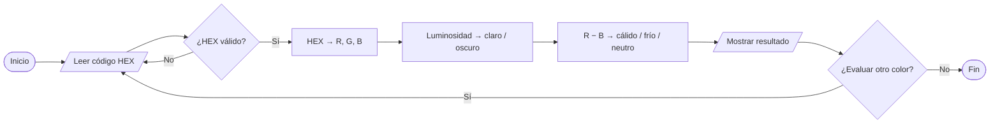
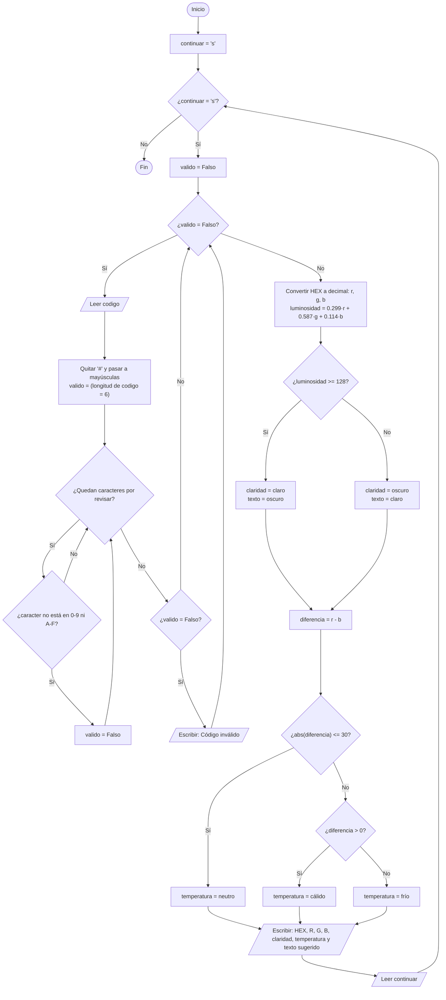

# 🎨 Clasificador de color (HEX → claro/oscuro · cálido/frío)

Algoritmo en Python que recibe el **código HEX** de un color y responde tres cosas:

1. ¿Es un color **claro** u **oscuro**?
2. ¿Su temperatura es **cálida**, **fría** o **neutra**?
3. ¿Qué **tono de texto** (claro u oscuro) contrasta mejor sobre él?

Trabajo individual del curso de diseño de algoritmos: aplica estructuras **secuenciales**, **condicionales** y **cíclicas**.

---

## 🧭 Vista rápida



---

## 📏 Reglas del algoritmo

| Decisión | Regla | Resultado |
|---|---|---|
| **Claridad** | `luminosidad = 0.299·R + 0.587·G + 0.114·B` | `>= 128` → **claro** · `< 128` → **oscuro** |
| **Texto sugerido** | Tono contrario al fondo | fondo claro → texto **oscuro** · fondo oscuro → texto **claro** |
| **Temperatura** | `diferencia = R − B` | `abs(diferencia) <= 30` → **neutro** · `> 0` → **cálido** · `< 0` → **frío** |

---

## 🔀 Diagrama de flujo



**Leyenda:** `([ ])` inicio/fin · `[ ]` proceso · `{ }` decisión · `[/ /]` entrada/salida.

---

## 📝 Pseudocódigo

```text
INICIO
  continuar <- "s"
  MIENTRAS continuar = "s" HACER
      valido <- FALSO
      MIENTRAS valido = FALSO HACER
          LEER codigo
          codigo <- codigo sin "#" y en mayúsculas
          valido <- (longitud de codigo = 6)
          PARA cada caracter EN codigo HACER
              SI caracter no está en "0123456789ABCDEF" ENTONCES
                  valido <- FALSO
              FIN SI
          FIN PARA
          SI valido = FALSO ENTONCES
              ESCRIBIR "Código inválido"
          FIN SI
      FIN MIENTRAS
      r <- decimal de codigo[0:2]
      g <- decimal de codigo[2:4]
      b <- decimal de codigo[4:6]
      luminosidad <- 0.299*r + 0.587*g + 0.114*b
      SI luminosidad >= 128 ENTONCES
          claridad <- "claro"
          texto <- "oscuro"
      SINO
          claridad <- "oscuro"
          texto <- "claro"
      FIN SI
      diferencia <- r - b
      SI |diferencia| <= 30 ENTONCES
          temperatura <- "neutro"
      SINO SI diferencia > 0 ENTONCES
          temperatura <- "cálido"
      SINO
          temperatura <- "frío"
      FIN SI
      ESCRIBIR HEX, r, g, b, claridad, temperatura y texto sugerido
      LEER continuar
  FIN MIENTRAS
FIN
```

---

## 🧱 Estructuras de control utilizadas

| Estructura | Dónde aparece |
|---|---|
| **Secuencial** | Leer el código, convertirlo a R, G y B, calcular y mostrar el resultado |
| **Condicional** | Clasificar claridad (`if/else`) y temperatura (`if/elif/else`) |
| **Cíclica** | `while` de validación, `for` que revisa cada carácter y `while` que repite el programa |

---

## ✅ Pruebas

| Entrada | Claridad | Temperatura | Texto sugerido |
|---|---|---|---|
| `#000000` | oscuro | neutro | claro |
| `#FFFFFF` | claro | neutro | oscuro |
| `#FF0000` | oscuro | cálido | claro |
| `#0000FF` | oscuro | frío | claro |
| `#C8C8C8` | claro | neutro | oscuro |
| `#FFFF00` | claro | cálido | oscuro |
| `#00FF00` | claro | neutro | oscuro |
| `#FF8C00` | claro | cálido | oscuro |
| `ZZZ123`, `#12345` | — | — | Código inválido: vuelve a pedir el dato |

Ejemplo de ejecución:

```text
Ingrese el código HEX (ejemplo: #FF8C00): #FF8C00
Color #FF8C00 (R=255, G=140, B=0) -> claro, cálido. Texto sugerido: oscuro
¿Evaluar otro color? (s/n): n
```

---

## ▶️ Cómo ejecutarlo

Requiere **Python 3** (sin librerías externas).

```bash
# Windows
python clasificador_color_hex.py

# Mac / Linux
python3 clasificador_color_hex.py
```

---

## 📂 Contenido del repositorio

```text
.
├── README.md                    # Este documento
└── clasificador_color_hex.py    # Programa en Python, comentado
```

---

## ⚠️ Limitaciones

La temperatura es una **simplificación**: solo compara el canal rojo con el azul. Por eso algunos colores, como los verdes puros, quedan clasificados como **neutros**.


